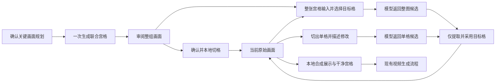

# 单分镜宫格联合生图与两种微调方式设计

日期：2026-10-12。当前代码基线：`dev@d15d6b7`。参考：`ArcReel/ArcReel@066e7a5`。

用户已确认采用 ArcReel 的联合宫格出图思路，优先解决单个分镜内动作不衔接、人物和场景变化的问题，并补充成本目标：首次整组生成。微调必须同时支持两种方式：根据整张宫格修改指定的一格或多格，以及切割后针对具体单格精修。本文固化该口径，业务代码尚未改动。

## 目标与范围

一个分镜段落包含 1～9 个按时间推进的关键画面。首次出图将这一分镜的有效画面统一规划、一次请求生成整张宫格；用户审阅后在本地切格，形成可以单独编辑的原始画面。后续可以选择整图微调指定的一格或多格，也可以选择切格后单格精修；两种方式都只采用用户选中的目标格，保留其余画面，并在采用后重新合成展示宫格及视频参考宫格。

一期包含连贯规划、联合生图、审阅与切格、基于原图和文字指令的两种微调、版本历史，以及现有视频参考流程的接续。像素范围涂抹/蒙版编辑属于后续增强；一期的“微调”表示编辑选中画格的内容，不承诺目标格内未指定修改的像素完全不变。未选中画格的原始内容由程序保留。跨分镜组联合出图和跨集连续性不在一期范围内。

## 核心流程

首次生成和重新生成得到候选联合图，不自动覆盖当前画面；切格确认才使其进入当前生产版本。整图微调既可用于审阅中的候选联合图，也可用于已采用画面重新组装出的当前联合图。两种微调结果均先预览，由用户采用后替换目标格；对未采用的联合图进行整图微调，结果仍是候选图，需要确认切格才能进入当前生产版本。生成失败、关闭预览和放弃候选结果均保留当前画面。

## 画面规划与提示词

- 一格对应一个可见的静态关键状态，不能把“伸手、抓住、举起、喝下”全部写成同一格中的连续动作。
- 全组共同约束包括人物身份与服装、场景空间关系、光源方向与色温、道具外观，以及原剧本允许的镜头变化。
- 相邻格明确记录动作衔接：上一格的状态、发生的变化、当前格的状态。人物换位、道具换手和视线方向改变须有剧情或动作依据。
- 景别、机位与构图按原分镜内容规划。删除“每帧都必须改变景别”的倾向；保留原本已规划的切镜。
- 规划上下文同时读取分镜画面描述、视频动作提示词、已有画面、角色/场景/道具的描述，以及共同资产身份。主提示词与技能必须使用同一字段约定，避免一个要求 prompt 写景别、另一个要求禁止写景别。
- 输出规划包含共同约束与每格 ID、时间、静态描述、景别、机位、构图、与上一格的衔接关系。已有 ID 保持稳定，不能用行列位置替代业务 ID。
- 时间点按动作节奏生成，保证递增且位于本分镜时长内。无法确定时可以采用现有等距默认值，并允许用户调整。
- AI 失败产生的规则方案标为“规则草稿”，保留用户确认步骤；不得自动把重复分句当成已通过连续性审查的规划。
- 联合生图提示词同时描述整组内容、行列几何、阅读顺序、占位位置、全局不变量和每格状态。图片模型不绘制编号、文字、水印、分隔线或边框。

## 生图布局与展示布局

联合生图优先采用相同行列数，减少单格比例与模型支持比例的冲突：

| 有效画面数 | 生图布局 | 有效格 | 展示布局 |
| ---: | --- | --- | --- |
| 1 | 1×1 | 1 | 1×1 |
| 2 | 2×2 | 前 2 格 | 2×1 |
| 3～4 | 2×2 | 前 N 格 | 2×2 |
| 5～6 | 3×3 | 前 N 格 | 3×2 |
| 7～9 | 3×3 | 前 N 格 | 3×3 |

所有位置按从左到右、从上到下映射。多余格采用无内容的中性背景，不分配画面 ID、时间或序号，不写入原始画面，也不参与视频画面计数。生图布局与展示布局的映射随任务冻结，页面不得按当前数量猜测历史图的切格位置。

相同行列数下，整图比例与单格比例可以相同。按所选模型实际支持的比例和输出分辨率选择生图参数；每格有效分辨率需要在预检与结果预览中可见。优先在模型支持时提供 2K/4K 档，格数增大时提示清晰度变化。禁止把小图放大后宣称其获得了原生高分辨率。

切分按实际返回图片尺寸与冻结的行列数计算边界，完整保存有效画面，不机械套用 ArcReel 的统一 2% 去边。发现图像比例明显偏离、布局错误、额外文字或跨格内容时，允许审阅但不将其静默标为切分成功；返回具体原因并提供重新生成或上传替换。

现有展示布局保持完整适配原图、禁止拉伸和裁切的原则。非方形展示格可能存在适配留边，这与联合生图中的占位格不同。

## 联合出图与切分

用户先确认画面规划，再提交联合生图。每个选中分镜对应一个联合生图任务和一次正常的图片模型提交，不再由“生成宫格”入口循环提交 N 个逐张任务。

提交前整体验证当前版本 revision、分镜归属、1～9 数量、共同资产、模型参考图上限、输出比例/分辨率和待冲突任务；预检不通过时该批次不创建部分付费任务。参考图取有效画面所需资产的并集，保持稳定顺序，并按实际传输序位声明身份。超过模型上限必须提示调整，不能静默丢弃关键资产。

任务冻结分镜规划、帧 ID 与时间、生成布局、模型配置、提示词、资产参考图片字节摘要和输入版本。任务完成后保存候选联合图、实际尺寸、任务 ID、输入摘要和生成时间。用户可重新生成候选联合图或上传自己的联合图替换，已有当前画面保持可用。

确认切格时再校验当前版本、分镜规划与冻结映射，避免生成期间用户已改顺序、数量或内容而发生错格。若已变化，保留候选图供查看并提示重新生成，不自动对应到新规划。

切格先写入所有目标格的临时文件、校验解码和几何，再在同一业务提交中更新当前帧 URL、来源记录、历史和 revision。中途失败不写回部分新画面；重试切分不会再次调用图片模型。当前版本或目标画格已锁定时禁止采用和覆盖。

## 两种微调方式

### 方式一：根据整张宫格修改指定格

用户在整图上选择一格或多格，并为各目标格填写修改指令，或对选中的目标格填写共同指令。例如“第 2 格右手抬高，第 4 格减弱表情”。选择范围必须来自有效帧 ID，不能选择占位格；序号与当前编辑画布的位置映射随请求冻结。

模型收到完整当前宫格、目标格位置、对应指令、共同资产与不变量，一次请求返回修改后的完整宫格。整图让模型同时看到其他格，方便参考人物、空间与动作关系。提示词声明只修改指定格，保持格数、布局、比例和其他格内容不变，不重新绘制文字或角标。

未选中格的保护由本地处理落实：验证模型返回图的几何与格位后，按冻结映射只切出目标格，将这些格与原图中未选中的格重新拼合。不得直接把模型返回的整张图覆盖当前宫格。对已采用画面操作时，未选中格的原始 URL、内容、ID、时间和历史均不变；对未采用候选图操作时，同样从原候选图保留未选中格。

当前编辑画布必须体现已采用的所有单格修改：在原联合图产生后某格已精修，下一次整图微调须由最新原始画面重新组装编辑宫格，不能再次使用过时的初次联合图。编辑画布沿用生图的等比例方形行列，展示宫格仍使用原自适应布局；编号通过帧 ID 映射，不把展示行列误认为编辑行列。

候选预览展示原图与“保留原未选中格、仅合入目标格”的处理后结果，并明确目标格数量。用户采用后一次更新这些目标格，任一目标格锁定或输入已改变则整次采用失败，不部分写回。原完整模型返回图作为候选来源记录保留，便于追溯，但不直接成为当前视频输入。

这是一张宫格的一次图片模型调用；选中两格不等于请求两次。费用按整图输入、输出分辨率及模型计价产生，不能按选中格的面积估算为单格费用。

### 方式二：切割后单格精修

交互为“点击有效格 → 查看切出原图 → 输入修改指令 → 生成单格候选 → 对比 → 采用/放弃”。这一方式一次精修一格，模型输出完整单格画面，适合脸部表情、手势、道具和构图细节。切格与图片读取在本地完成，不调用模型。对已有当前原始画面直接使用该格；对尚未采用的联合图，先确认切格再进入当前单格精修。

微调输入包括选中格的当前原图、修改指令、共同不变量、共同资产，以及按参考图上限选择的相邻画面。当前原图优先级最高，至少保留必需身份资产；相邻图按前后顺序记录用途。模型或配置不能接收所需输入时在提交前阻止，不能静默退回不带原图的纯文本生图。

微调提示词明确当前原图是编辑对象，相邻画面仅用于连续性参考；只输出选中格的完整画面。保留原图的身份、服装、背景布局、机位、光色和当前动作阶段，除非修改指令明确要求改变其中一项。该方式每次只提交一格；不能由“单格精修”入口切换为整图重画。

候选结果生成后不立即覆盖：显示原图与候选的对比，用户采用时只更新该格的图片与必要的修改记录；其他格的 URL、ID、时间、描述和历史不变。任务启动后的原图变化、时间线变化或版本锁定会使采用校验失败；旧候选仍可查看，不自动覆盖最新状态。

### 两种方式共用的采用与历史规则

保留每格历史与原联合图版本。采用目标格后，当前展示和视频宫格必须由当前原始画面重新合成；不得再次直接使用旧联合图而丢失微调。当前格状态需要展示“已微调”，历史记录区分“整图指定格微调”和“单格精修”，并能回退到切分版本或之前采用的版本。

两种方式都冻结编辑方式、目标帧 ID、原图摘要、格位映射、修改指令、参考输入和版本。用户要求换装、场景变化等会影响整组一致性时，界面提示核对所有受影响格，但不得自动扩大选择范围或额外发起任务。用户明确选择的修改优先于默认不变量。

生成整个新联合图会替换所有画格的候选内容，入口明确为“重新生成整组”，采用前显示受影响画面数。它与“根据现有整图微调指定格”是不同动作，后者必须以原图和修改指令作为编辑依据。整组采用仍遵守所有目标格的锁定与历史规则。

## 成本与任务行为

| 操作 | 是否调用模型 | 调用范围 |
| --- | --- | --- |
| AI 画面规划 | 是，文本模型 | 本分镜规划 |
| 首次/重新生成联合宫格 | 是，图片模型 | 本分镜整组，一次正常提交 |
| 切格、编号、缩略图、重新合成 | 否 | 本地图片处理 |
| 整图指定格微调 | 是，图片模型 | 整张宫格输入与输出，一次正常提交，可选多个有效格 |
| 切格后单格精修 | 是，图片模型 | 一格，一次正常提交 |
| 候选采用、放弃、切分重试、历史回退 | 否 | 本地数据与图片处理 |

调用次数减少不等于费用按相同比例减少，实际账单仍受模型、分辨率、失败及人工重试影响。只有供应商提供计价依据时显示估价；否则展示本次出图数量与分辨率，并记录任务 ID、模型、实际用量和可获得的费用数据，不显示虚构的节省比例。

同一冻结输入和编辑方式的在途联合生图或微调重复点击返回既有任务，不重复提交。整图微调的去重包含目标格集合与各格指令，不能将不同修改误认为同一任务。没有生成意图的页面轮询、刷新与状态读取不得入队。服务器重启后优先恢复已取得的供应商任务/已下载结果；状态不明时提示用户处理，不自动再次付费提交。失败重试由用户明确触发，新的模型提交记为新的尝试。

## 与现有产物和视频的关系

保留当前原始画面作为采用后的生产真值，新增的候选联合图是生产来源与可审阅版本；当前 `frame_contact_sheets` 继续承担从原始画面派生展示图、干净图和缩略图的角色，不混入付费联合生图状态。

每格记录切分来源的联合图 ID、原始格位置/裁切边界，以及微调方式、任务与原图摘要。整图微调记录还保存完整输入宫格摘要、目标格集合和模型返回的整图来源。采用或回退改变原始画面后，按现有方式使宫格过期并重新合成。新的展示图与视频图由当前格组成，角标由系统叠加；干净版本无角标或分隔线。

保留 `direct` / `storyboard_frames`、`individual` / `contact_sheet` / `auto` 与分镜/组合视频生成的现有选择规则。本次优化出图方式，不擅自改变视频参考策略。使用宫格参考时输入当前有效画面组成的干净宫格；使用逐张参考时输入当前有效画面。视频提示词仍明确格序、时间与成片不显示宫格的要求。

视频任务已经冻结的旧输入不因后续微调被改写。新视频任务在所有原始画面就绪、所选输入可用且快照校验通过后提交；候选联合图或微调图不算已采用画面。历史超过 9 张的分镜仍可查看、删除和编辑，整理到 1～9 后才能进行新联合生图与相应视频提交。

## 模型传输前置条件

实现前核实当前图片服务、模型和实际 API 端点支持的参考图、图像编辑、输出比例和尺寸。现有火山图片适配器和 Gemini 3 图像模型官方 interactions 分支未实发参考图，必须纠正或明确禁用这些路径的联合参考生图及两种微调入口。

对每条支持路径测试实际请求构造：参考图片须作为图片内容传输，不仅在 prompt 中提及“参考图”。模型上限计数、提示词图号与发送顺序一致。自定义工作流须验证配置中真正映射了原图及参考图字段。

联合出图、整图指定格微调与单格精修在不同图片模型上的能力和效果分别声明；不能因为某模型支持文本生图就默认开放基于原图的微调。相邻参考过多时不静默去掉必需原图或身份资产。

## 模块边界与实施顺序

1. **能力与请求传输**：在图片适配器和能力查询中表达参考图、编辑、比例及尺寸约束；修复缺失图片输入的路径，加入请求构造测试。
2. **连贯规划**：统一 `frame_splitter` 主提示词、语言变体和技能，扩展 `previs-frames` 与只读上下文工具以表达共同约束、静态状态和相邻关系；保留旧规划的读取与编辑。
3. **联合生成领域模型**：独立定义生成布局、冻结的帧映射、输入摘要、候选状态与来源。新增候选记录表及启动恢复处理，复用现有 `sys_task` 的供应商调用与媒体落盘。
4. **切格与采用**：独立服务负责解码、边界计算、文件暂存、revision/锁定校验、完整提交、历史记录与派生宫格失效，不包含图片模型调用。
5. **两种微调**：整图微调独立构造当前编辑宫格、目标格集合与指令，模型返回后仅提取目标格；单格精修独立构造原图/相邻图/资产参考与修改指令。共用候选审阅、采用和任务恢复约定，接续现有逐格历史和上传能力。
6. **页面接入**：在主工作台与独立预演页使用同一联合生成、候选审阅和两种微调组件。整图提供多格选择和对应指令，单格提供精修对比；保留概览/编辑双态。
7. **验证**：先验证数量、几何、请求、冲突和不重复提交，再进行浏览器操作验证；最后用同模型真实样本比较视觉连续性、单格清晰度、实际调用与费用。

## 验收标准

1. 1～9 个有效画面映射正确；3×3 宫格的不足格不进入原始画面或视频计数。
2. 一个分镜的一次正常联合生图提交只创建一个图片模型调用，重复点击、轮询、刷新不增加调用。
3. 每条开放的参考生图/微调路径实际携带图片输入，且序号、身份与引用一致；超限整批拒绝。
4. 每格只有一个静态关键状态，相邻动作能衔接；共同人物、服装、背景、光源和道具保持合理一致，切镜符合原分镜。
5. 候选联合图生成不覆盖当前帧；切分无需模型调用，确认后按冻结 ID 写回，冲突、锁定或切分失败不部分覆盖。
6. 点击第 N 个有效格编辑的是对应画面；1、3、6、9 格及横/竖版页面映射一致，空格不可进入画面编辑。
7. 整图微调选中第 2、4 格时只创建一次模型调用，实发完整当前宫格和对应指令；即使模型改动未选中格，本地只采用第 2、4 格，保留其余原始画面。
8. 单格精修只提交一格并引用原图；两种方式采用前原图保持当前状态，放弃候选不改变数据。采用后未选中格的 URL、ID、时间和历史完全不变；可回退目标格，当前展示与视频宫格自动更新。
9. 微调期间修改原图、规划或锁定版本会阻止旧结果自动采用；已提交的视频输入仍保留原快照。
10. 已有逐张生成/上传的历史画面照常读取、编辑与生成视频，新增默认联合出图不强制重新生成历史内容。
11. 模型失败、下载失败、本地切分失败和状态不明分别显示原因与对应处理入口；切分/合成重试不创建图片模型任务。
12. 先单格精修再整图指定格微调时，输入宫格包含最新已采用的精修结果；两种方式交替采用和回退不丢失其他格的修改。
13. 真实样本覆盖单人动作、双人对话、持物/交接，以及横/竖版 3、6、9 格；分别验证两种微调的效果，记录实际清晰度、连续性、调用次数和可获得的费用，不以 mock 通过替代视觉效果验收。

## 参考源码

- ArcReel：`lib/script/grid/prompt_builder.py`、`lib/script/grid/layout.py`、`lib/artifacts/generation_input.py`、`server/services/tasks/generation_tasks.py`、`server/services/grid/grid_split.py`。
- 当前项目：`backend/src/services/previs-frames.ts`、`previs-batch.ts`、`previs-contact-sheet-domain.ts`、`previs-contact-sheets.ts`、`previs-contact-sheet-renderer.ts`，`backend/src/agents/tools/frame-splitter-tools.ts`，`frontend/app/components/previs/StoryboardFramesEditor.vue`、`FrameSettingsDialog.vue`。
- 现有宫格设计：`docs/superpowers/specs/2026-10-12-storyboard-contact-sheet-design.md`。本文扩展生产来源与局部微调；现有展示布局、派生缓存和视频快照规则按上述关系继续适用。
